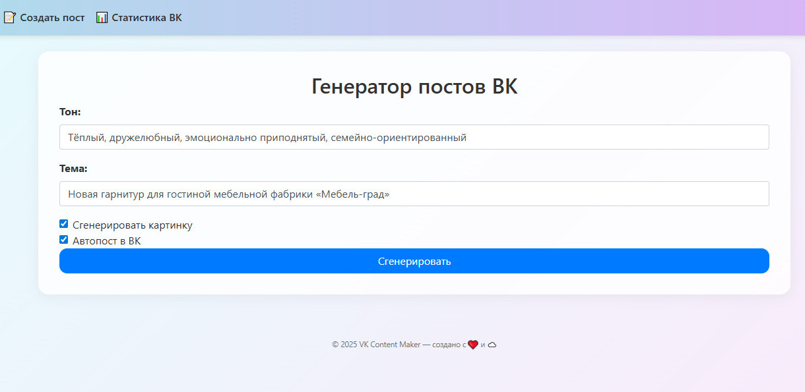
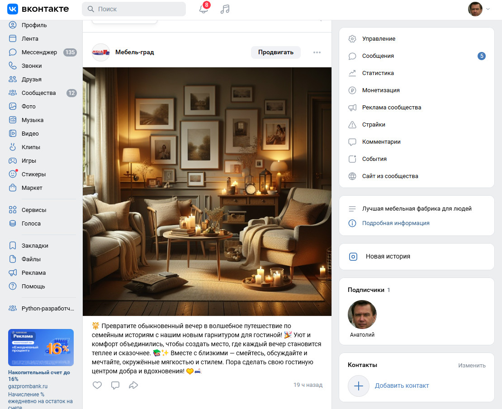
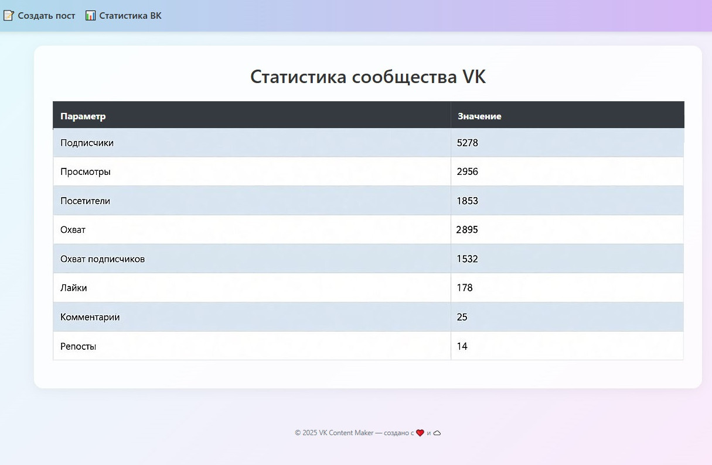

# SMM Automation for VKontakte

Веб-приложение на Flask для автоматизации SMM-продвижения бизнеса во ВКонтакте.  
Система использует нейросети для генерации уникального контента (текст + изображение) на основе заданной темы и тона общения, автоматически публикует посты в целевое сообщество и предоставляет ключевую статистику эффективности.

Решение помогает бизнесу поддерживать живую и эмоционально настроенную ленту без ежедневного ручного вмешательства.

## Возможности

- **Генерация постов** — создание текстов на заданную тему, в выбранном тоне и стиле
- **Генерация изображений** — автоматическое создание картинок через DALL·E 3 на основе описания поста
- **Автопубликация** — мгновенная публикация готового поста в сообщество ВКонтакте
- **Статистика** — ключевые метрики сообщества за последние 7 дней:
  - Подписчики
  - Просмотры и посетители
  - Охват (общий и подписчиков)
  - Лайки, комментарии, репосты
- **Веб-интерфейс** — удобная панель управления для настройки, генерации и просмотра аналитики

## Архитектура

Проект построен на Flask с разделением на модули:

| Модуль | Описание |
|--------|----------|
| `app/smm.py` | Blueprint с маршрутами: dashboard, settings, post-generator, vk-stats |
| `app/auth.py` | Авторизация и регистрация пользователей |
| `app/models.py` | Модель User |
| `generators/text_gen.py` | `PostGenerator` — генерация текста поста и промпта для изображения (GPT-4o) |
| `generators/image_gen.py` | `ImageGenerator` — генерация изображений через DALL·E 3 |
| `social_publishers/vk_publisher.py` | `VKPublisher` — загрузка фото и публикация на стену сообщества |
| `social_stats/vk_stats.py` | Получение статистики сообщества (подписчики + данные за период) |

### Основной сценарий работы

1. Пользователь выбирает тему и тон поста.
2. Система генерирует текст поста с помощью GPT-4o.
3. По желанию генерируется изображение через DALL·E 3.
4. При включённой автопубликации пост сразу публикуется в сообщество ВК.
5. На отдельной странице доступна сводная статистика за последние 7 дней.

## Технологии

- **Python 3.10+**
- **Flask** + Blueprint
- **OpenAI API** (GPT-4o + DALL·E 3) через ProxyAPI
- **VKontakte API** (wall.post, photos.*, stats)
- **SQLAlchemy** (модель User)
- **Requests**

## Структура проекта
```text
.
├── app/
│   ├── __init__.py
│   ├── auth.py                 # Авторизация и регистрация
│   ├── models.py               # Модель User
│   ├── smm.py                  # Blueprint SMM (dashboard, settings, post-generator, stats)
│   └── templates/
│       ├── base.html
│       ├── dashboard.html
│       ├── login.html
│       ├── post_generator.html
│       ├── register.html
│       ├── settings.html
│       └── vk_stats.html
├── generators/
│   ├── text_gen.py             # PostGenerator
│   └── image_gen.py            # ImageGenerator
├── social_publishers/
│   └── vk_publisher.py         # VKPublisher
├── social_stats/
│   └── vk_stats.py             # VKStats
├── config.example
├── main.py
├── requirements.txt
└── README.md
```

## Установка и запуск

### Требования

- Python 3.10 или выше
- API-ключ [ProxyAPI](https://proxyapi.ru) (или совместимый OpenAI-endpoint)
- Токен доступа ВКонтакте с правами на управление сообществом
- ID сообщества ВКонтакте

### 1. Клонирование репозитория

```bash
git clone https://github.com/your-username/smm-vk-automation.git
cd smm-vk-automation
```

### 2. Создание виртуального окружения

```bash
python -m venv venv
source venv/bin/activate        # Linux / macOS
# или
venv\Scripts\activate           # Windows
```

### 3. Установка зависимостей

Создайте файл `requirements.txt`:

flask==3.0.2
flask-cors==4.0.0
python-dotenv==1.0.1
openai>=1.35.0
requests==2.31.0
flask-bcrypt==1.0.1
flask-sqlalchemy==3.1.1
flask-wtf==1.2.1

Установите:

```bash
pip install --upgrade pip
pip install -r requirements.txt
```

### 4. Настройка переменных окружения

Создайте файл `config.py`:

PROXYAPI_KEY=ваш_ключ_proxyapi
BASE_URL=https://api.proxyapi.ru/openai/v1
SECRET_KEY=ваш_секретный_ключ_flask
DATABASE_URL=sqlite:///app.db

### 5. Настройка пользователя

После регистрации / входа в систему перейдите в **Настройки** и укажите:

- `VK API Token` (токен доступа сообщества или пользователя с правами администратора)
- `VK Group ID` (числовой ID сообщества без минуса)

### 6. Запуск

```bash
flask run
# или
python run.py
```
Приложение будет доступно по адресу [http://127.0.0.1:5000](http://127.0.0.1:5000)

## Использование

### Генерация и публикация поста

1. Перейдите в раздел **Генератор постов**.
2. Укажите:
   - Тему поста
   - Тон общения (например: дружелюбный, экспертный, игривый, продающий)
3. Отметьте нужные опции:
   - Генерировать изображение
   - Автоматически опубликовать во ВКонтакте
4. Нажмите кнопку генерации.
5. Получите готовый текст (и изображение) и, при необходимости, сразу опубликованный пост.

**Форма ввода**



**Пример поста в VK**



### Статистика

В разделе **Статистика ВК** отображаются:

- Текущее количество подписчиков
- Суммарные показатели за последние 7 дней:
  - Подписчики
  - Просмотры
  - Посетители
  - Охват
  - Охват подписчиков
  - Лайки
  - Комментарии
  - Репосты



## Особенности реализации

- Генерация текста выполняется моделью **GPT-4o**.
- Изображения создаются через **DALL·E 3** (размер 1024×1024).
- Загрузка изображений во ВКонтакте происходит через стандартный механизм `photos.getWallUploadServer` → upload → `photos.saveWallPhoto`.
- Публикация выполняется методом `wall.post` от имени сообщества (`from_group=1`).
- Статистика агрегируется за последние 7 дней.

## Возможные улучшения

- Планировщик публикаций (отложенный постинг)
- Поддержка нескольких сообществ
- Более детальная аналитика и графики
- Шаблоны промптов и сохранение успешных постов
- Интеграция с другими соцсетями (Telegram, Instagram)
- A/B-тестирование заголовков и изображений
- Кэширование сгенерированных изображений

## Лицензия

MIT
